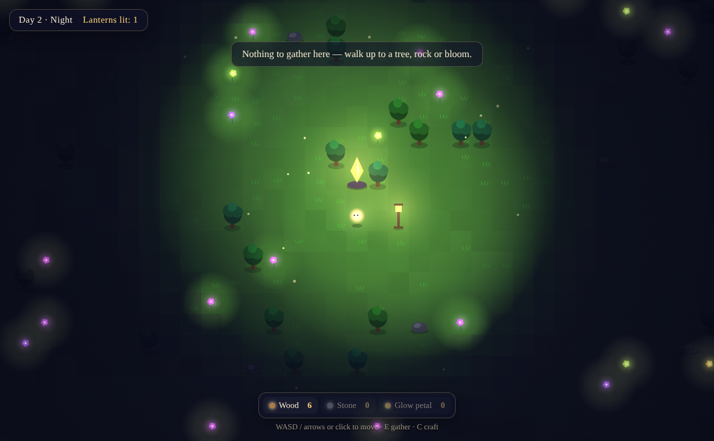

# Lumen

A cozy game that builds itself — one improvement every night, made by Claude.

The world has faded to grey. You are its last small light. Gather, craft and
build lanterns to bring the colour back.

## Play
Open `index.html` in a browser (or play it on GitHub Pages if it's turned on).

- **Move:** WASD / arrow keys, or click/tap where to go
- **Gather:** E or Space near a tree, rock or bloom (or click it)
- **Craft:** C, then pick something and click where to build
- Progress saves automatically.

## How it grows
Every night a scheduled Claude session reads `CLAUDE.md` and `ROADMAP.md`,
builds the next feature, tests it, and writes what it did in `CHANGELOG.md`.
